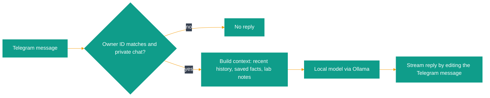
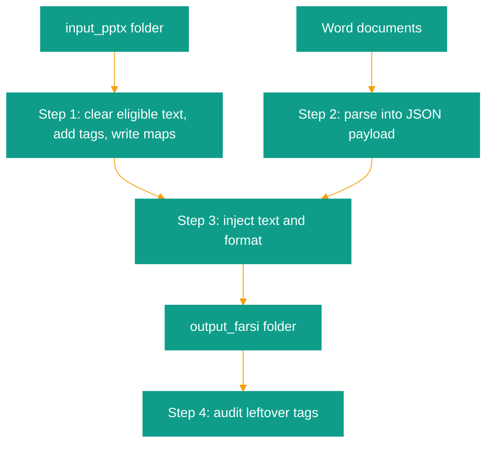
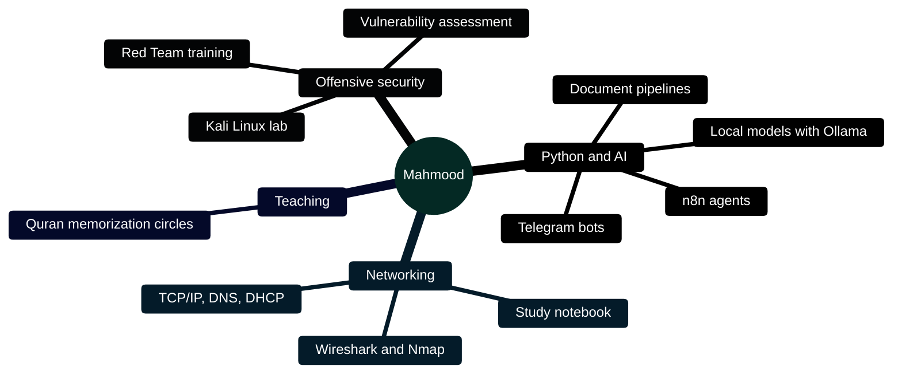
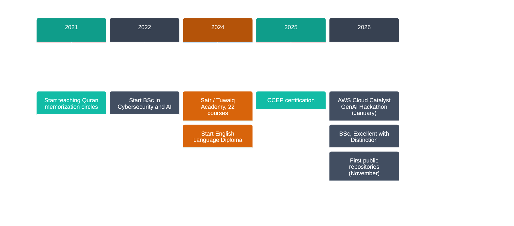

<div align="center">

# Mahmood Abdulqhar Mohamad

**Cybersecurity & Artificial Intelligence Graduate**
Riyadh, Saudi Arabia

<a href="https://mahmood-abdulqhar.pages.dev/">
  
</a>

<br>

<a href="https://mahmood-abdulqhar.pages.dev/"></a>
<a href="https://www.linkedin.com/in/mahmood-abdulqhar-mohamad-5a0539339"></a>
<a href="https://x.com/id_er2"></a>
<a href="https://mahmood-abdulqhar.pages.dev/Mahmood_Abdulqhar_Mohamad_CV.pdf"></a>

<br>


</div>

<br>

## // about

Cybersecurity and AI graduate. I build practical tools with Python and local language models, practise vulnerability assessment and threat analysis in my own lab, and write down what I learn. I am looking for an entry-level cybersecurity or AI role in Riyadh.

```python
class Mahmood:
    degree   = "BSc Cybersecurity & AI (Excellent with Distinction, 2026)"
    focus    = ["Python automation", "local LLMs", "vulnerability assessment"]
    lab      = "Kali Linux + revived old devices"
    studying = ["Red Team training", "n8n agents", "networking"]
    outside  = "Quran teacher since 2021"
    seeking  = "entry-level cybersecurity / AI role, Riyadh"
```

> I learn by building, then I write down what I built.

<br>

## // projects

| Project | What it is | Stack | Status |
|---|---|---|---|
| [private-telegram-assistant](https://github.com/id-er2/private-telegram-assistant) | Owner-only Telegram study assistant for cybersecurity. Runs on a local model through Ollama, sends nothing to a cloud service, and ships with 23 offline tests. | Python, Ollama, Telegram Bot API | Published |
| [presentation-pipeline](https://github.com/id-er2/presentation-pipeline) | Reads text from Word files, fills tagged PowerPoint templates (including Persian, right-to-left) and reports leftover placeholders. | Python, python-pptx, python-docx, lxml | Published |
| [mahmood-abdulqhar.pages.dev](https://mahmood-abdulqhar.pages.dev/) | My portfolio site: skills, projects, education, certificates with verification links, and CV download. Plain HTML and CSS. | HTML, CSS, Cloudflare Pages | Live |
| Self-hosted AI agent | A personal agent on n8n that automates workflows on local models, designed to run on limited hardware. | n8n, Ollama, Llama 3, Qwen 2.5 | In progress |
| Networking study notebook | Arabic notes on networking fundamentals, TCP/UDP, application protocols and protection principles, written from course summaries. First of a planned series. | Writing | In progress |
| Alem (AWS Cloud Hackathon, Team ZeroDay) | AI educational platform built within a team. I worked on cloud-deployment security on AWS and AI-driven lesson-planning features. | AWS, Python | Hackathon, Jan 2026 |

<br>

## // tech arsenal

**Languages and scripting**


**Web and APIs**


**Data and machine learning** (Satr / Tuwaiq courses)


**AI and LLMs**


-F59E0B?style=flat-square&logo=n8n&logoColor=white)

**Security**


**Systems and cloud**

-374151?style=flat-square&logo=linux&logoColor=white)


<br>

## // how the projects work

**private-telegram-assistant**



**presentation-pipeline**



<br>

## // focus areas



<br>

## // experience

**Quran Instructor** - Maknoon Charitable Society for Quran Memorization, Riyadh (2021 - present)<br>
Paid memorization circles: planning structured lessons and tracking each student's progress. Also a volunteer deputy imam at a local mosque, leading congregational prayers.

**Security practice**
- Took part in the Black Hat CTF challenge.
- AWS Cloud Catalyst GenAI Hackathon (January 2026), Team ZeroDay: cloud-deployment security and AI lesson-planning features for Alem.
- Home lab: Kali Linux and private test environments, plus reviving old devices.
- Red Team training through self-study, with Kali labs. This is self-study, not a formal enrolment.

<br>

## // timeline



<br>

## // education

| Degree | Details |
|---|---|
| **BSc Cybersecurity & Artificial Intelligence** | Islamic University of Minnesota (online), 2022 - 2026. Excellent with Distinction. |
| **English Language Diploma** | Islamic University of Minnesota (online), 2024 - 2026. Excellent, 96.5%. |

<br>

## // certifications

| Issuer | Courses |
|---|---|
| Red Team Leaders (2025) | Certified Cybersecurity Educator Professional (CCEP) |
| Satr / Tuwaiq Academy (2024) | 22 courses, 48 hours: Introduction to Cybersecurity, Python 101-104, Git 101, Intro to Data Science, SQL 101-103, NumPy, Pandas, Matplotlib, Seaborn, Exploratory Data Analysis, Machine Learning (ML-101), HTML, CSS, Bootstrap, Django 101-103 |
| Cisco Networking Academy | Introduction to Cybersecurity, Networking Basics, Endpoint Security, Introduction to Data Science |
| Google / Coursera | Foundations of Cybersecurity, Play It Safe, Connect and Protect |
| IBM SkillsBuild | Cybersecurity Fundamentals |
| HP LIFE | Introduction to Cybersecurity Awareness, AI for Beginners |
| Edraak | Cybersecurity Essentials; Learn English: Conversational Skills for Beginners (British Council) |
| Islamic University of Minnesota | AI Applications |

**Languages:** Persian, Arabic, English

<br>

## // working style

- **Teaching and communication.** Five years of running Quran memorization circles, which means explaining the same thing several ways until it lands.
- **Documentation.** Every course I finish becomes a written notebook I can return to.
- **Working within limits.** My local AI tooling runs on a 16 GB laptop, so I keep it light.
- **Self-directed.** Most of my security and automation skills come from labs and projects I set up myself.

<br>

## // now

- Red Team training and Kali labs
- n8n self-hosted agent
- Git, properly this time
- Networking notebook series
- Applying for entry-level cybersecurity and AI roles in Riyadh

<br>

## // stats

<p align="center">
  
  
</p>

<p align="center">
  
</p>

<br>

## // contact

[Website](https://mahmood-abdulqhar.pages.dev/) | [CV (PDF)](https://mahmood-abdulqhar.pages.dev/Mahmood_Abdulqhar_Mohamad_CV.pdf) | [LinkedIn](https://www.linkedin.com/in/mahmood-abdulqhar-mohamad-5a0539339) | [X](https://x.com/id_er2) | mahmood.abdulqhar@gmail.com
