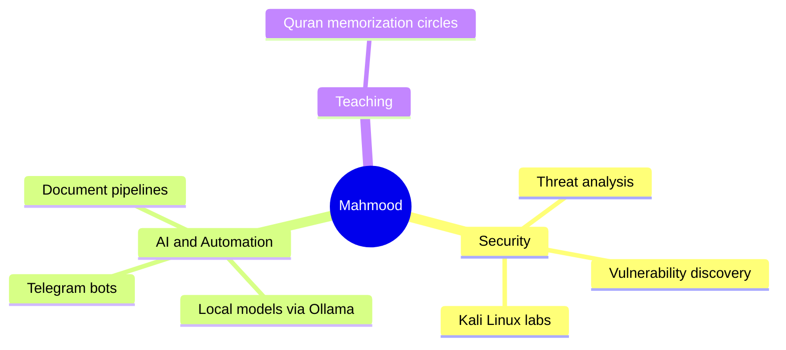

<h1 align="center">Hi, I'm Mahmood 🚀</h1>
<h3 align="center">Cybersecurity &amp; AI Graduate</h3>

<p align="center">
  <a href="https://id-er2.github.io/">
    
  </a>
</p>

<p align="center">
  <a href="https://id-er2.github.io/"></a>
  <a href="https://www.linkedin.com/in/mahmood-abdulqhar-mohamad-5a0539339"></a>
  <a href="https://x.com/id_er2"></a>
  <a href="https://id-er2.github.io/Mahmood_Abdulqhar_Mohamad_CV.pdf"></a>
</p>

<p align="center">
  
</p>

---

## 💻 About Me

Cybersecurity and AI graduate. I train in vulnerability discovery and threat analysis, build practical projects with Python and local AI models, and document what I learn here, one project at a time.

```python
class Mahmood:
    degree = "BSc Cybersecurity & AI"
    focus = ["Python", "threat analysis", "local AI"]
    currently_learning = "n8n automation"
    community = "Quran teacher since 2021"
```

> I learn by building, then I write down what I built.

---

## 📂 Featured Projects

### 🔐 [private-telegram-assistant](https://github.com/id-er2/private-telegram-assistant)

A private Telegram assistant running on a local model via Ollama - a cybersecurity study companion. It never sends conversations to a cloud service, stores nothing unless asked, and ships with 23 tests that run fully offline.

`Python` `Ollama` `Telegram Bot API`

### 📊 [presentation-pipeline](https://github.com/id-er2/presentation-pipeline)

An automation pipeline that prepares lesson slides: it reads text from Word files, fills PowerPoint templates, and reports any remaining placeholders. Tested end-to-end on real lesson templates.

`Python` `python-pptx` `python-docx` `lxml`

### 🤖 n8n AI agent - in progress

An AI agent built on n8n. The source and a full write-up will land here once it's done.

---

## 🛠️ Tech Arsenal

**Languages**


**AI & Messaging**


**Document Automation**


**Security & Publishing**


**Currently learning**


---

## 🧭 Core Competencies



---

## 🎯 Practical Experience

- Took part in a Capture the Flag challenge at Black Hat.
- AWS Cloud Catalyst GenAI Hackathon (January 2026) - proposed the project idea and researched how to implement it.
- Home lab: hands-on practice with Kali Linux and private environments, plus reviving old devices.
- Quran memorization teacher since 2021.

---

## 🎓 Education & Certifications

- **BSc in Cybersecurity & AI** - Islamic University of Minnesota (remote), 2026, Excellent with Distinction.
- **English Diploma** - 96.5%.
- Certifications from Cisco Networking Academy, Google, and IBM SkillsBuild.
- 22 courses (48 hours) across Satr and Tuwaiq Academy.

---

## 🧩 Soft Skills

- **Teaching and communication** - five years of running Quran memorization circles.
- **Documentation habit** - every course I take ends up as a written notebook I can come back to.
- **Working within constraints** - my AI tooling runs locally on a 16 GB laptop, tuned to stay light.

---

## 🌱 Currently Exploring

- n8n agents and workflow automation
- Git fundamentals, properly this time
- A networking study notebook series

---

## 📊 GitHub Analytics

<p align="center">
  
  
</p>

<p align="center">
  
</p>

---

## 📬 Let's Connect

[Website](https://id-er2.github.io/) · [Resume (PDF)](https://id-er2.github.io/Mahmood_Abdulqhar_Mohamad_CV.pdf) · [LinkedIn](https://www.linkedin.com/in/mahmood-abdulqhar-mohamad-5a0539339) · [X](https://x.com/id_er2)
